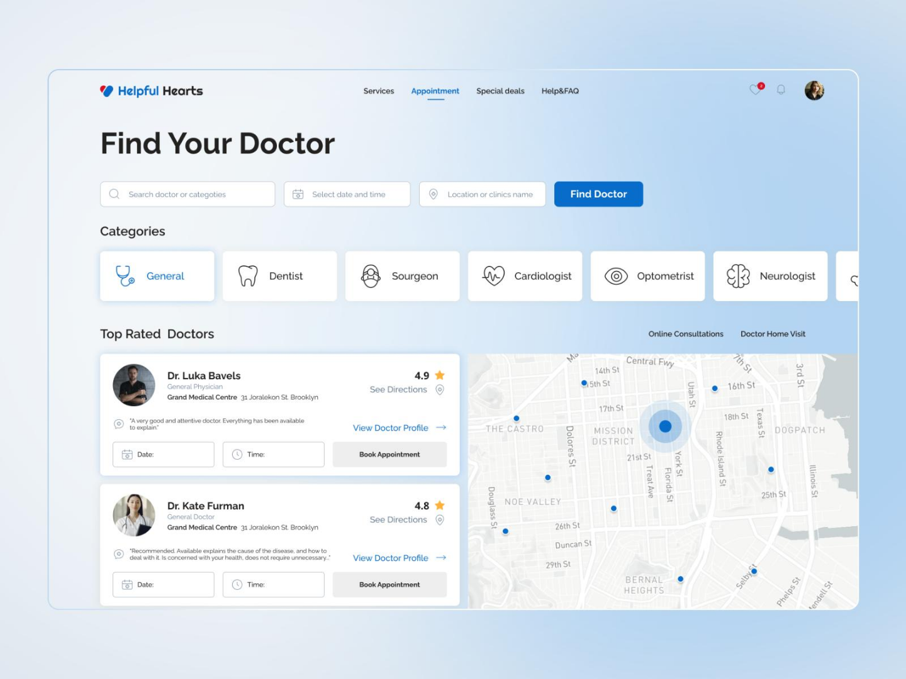

# Proyecto Salud

**Conectando a las personas con el servicio de salud correcto, en el momento correcto.**

_Directorio inteligente de servicios médicos para comunidades rurales y semiurbanas._



## Descripción

Proyecto Salud es un directorio de servicios médicos que orienta al usuario hacia el centro de salud más adecuado según su situación, ubicación, servicios disponibles, distancia y tiempo de traslado.

## Problema

En comunidades rurales y semiurbanas, muchas personas tienen dificultades para saber a dónde acudir cuando presentan un problema de salud, especialmente cuando el centro médico o el especialista más cercano no cuenta con el personal, el equipo o el servicio necesario.

Esto provoca:

- Traslados innecesarios
- Pérdida de tiempo
- Saturación de determinados centros de salud

Además, la información disponible suele limitarse a la _ubicación_ de hospitales o clínicas, sin indicar qué servicios tienen disponibles en ese momento, qué tan urgente es la situación o cuál es la mejor opción considerando distancia, capacidad y condiciones del paciente.

## Usuarios objetivo

El sistema está dirigido al **público en general** que busca atención médica, con especial atención a personas de comunidades pequeñas o sin médico de cabecera fijo.

- Rango de edad amplio
- Buscan desde chequeos de rutina hasta necesidades urgentes
- Necesitan comparar rápidamente costo, cercanía y horarios
- Requieren una **interfaz simple e intuitiva**

## Propuesta de solución

> _"Necesito un dentista"_

El sistema muestra los establecimientos cercanos con la siguiente información:

| Criterio              | Descripción                        |
| --------------------- | ---------------------------------- |
| Especialidad          | Tipo de servicio médico requerido  |
| Horario               | Disponibilidad horaria del centro  |
| Ubicación             | Distancia y ruta desde el usuario  |
| Teléfono              | Contacto directo                   |
| Servicios disponibles | Qué atención ofrece en ese momento |

## Tecnologías

- **PHP** con Composer
- **PostgreSQL** en Neon
- **HTML, CSS y JavaScript**
- API de mapas para mostrar la ubicación de los centros de salud

## Instalación

1. Clonar el repositorio:
   ```bash
   git clone https://github.com/JJovaNM/ProyectoSalud-.git
   ```
2. Entrar a la carpeta del proyecto:
   ```bash
   cd ProyectoSalud-
   ```
3. Instalar las dependencias de PHP:
   ```bash
   composer install
   ```
4. Copiar el archivo de ejemplo de configuración:
   ```bash
   cp .env.example .env
   ```
5. Abrir el archivo `.env` y escribir la URL de la base de datos (`DATABASE_URL`) y la clave del mapa (`API_KEY_MAPA`).
6. Iniciar el servidor local:
   ```bash
   php -S localhost:8000 -t home
   ```
7. Abrir en el navegador la dirección `http://localhost:8000`.

## Uso

1. Escribir en el buscador la especialidad o el servicio que se necesita.
2. Revisar la lista de centros de salud que ofrecen ese servicio.
3. Consultar en el mapa la ubicación y la ruta hacia el centro elegido.
4. Llamar al teléfono del centro para confirmar la disponibilidad.

## Equipo

| Integrante     | Rol               |
| -------------- | ----------------- |
| JJovaNM        | _Project Manager_ |
| Cristobal05-ux | Programador 1     |
| JuanCAD2       | Programador 2     |
| kikis          | Programador       |

---

_Proyecto desarrollado en el Instituto Tecnológico Superior de Huetamo._
